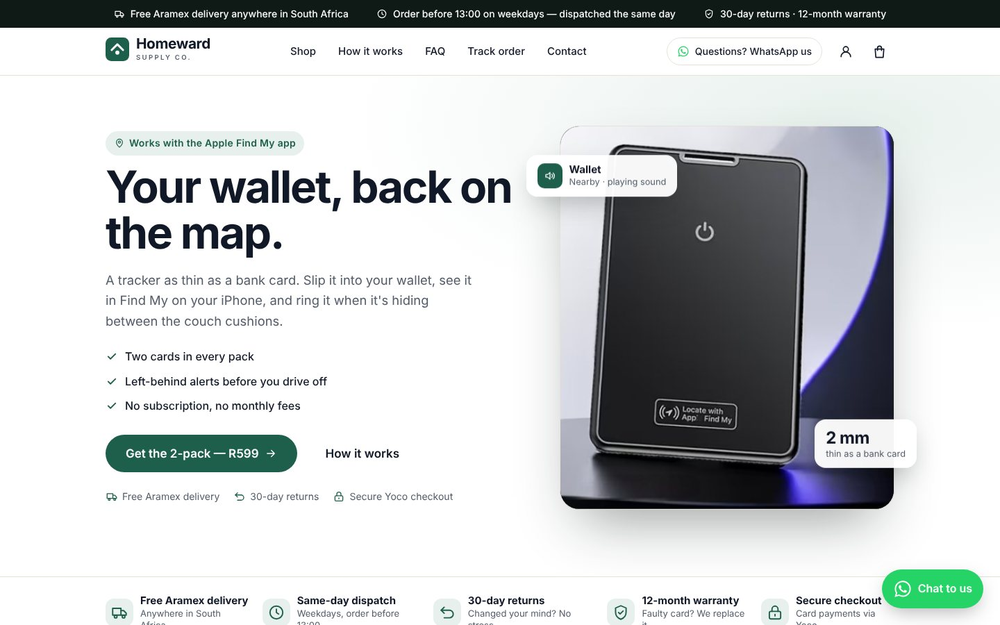
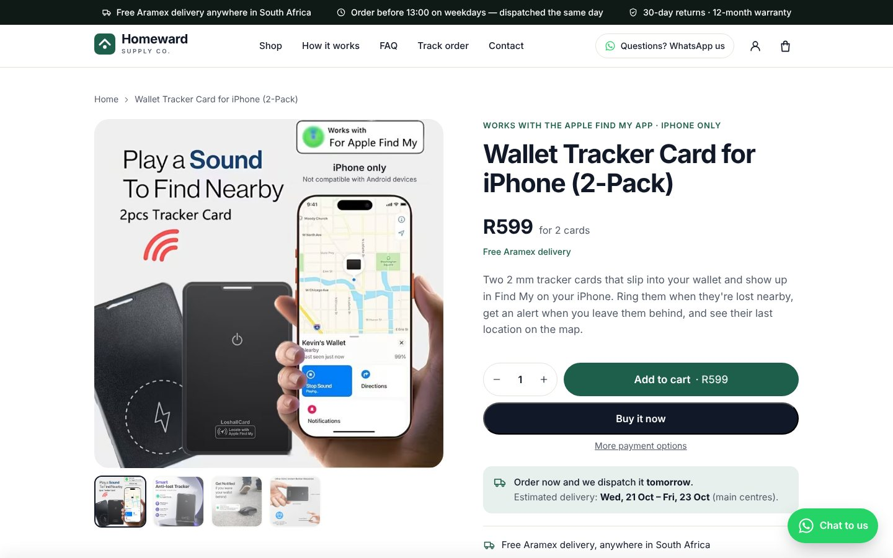
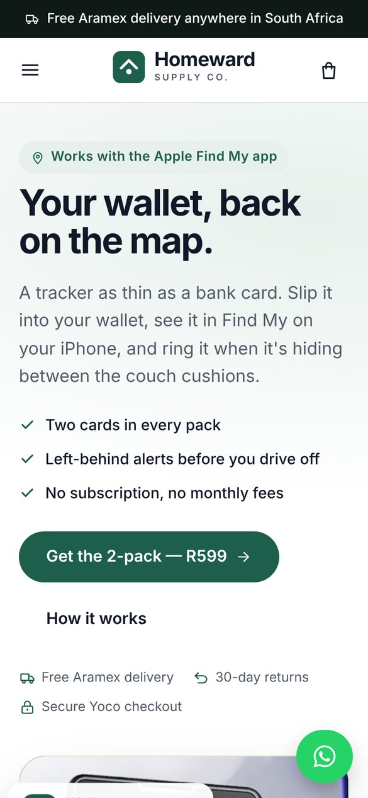

# Homeward Supply Co.

A complete, ready-to-launch Shopify store for South Africa, selling a slim **Find My-compatible tracker card for iPhone** (2-pack, **R599**), with **Yoco** card payments and **Aramex** delivery.



| Product page | Mobile |
|---|---|
|  |  |

## The name

**Homeward Supply Co.** *Homeward* means things finding their way back to you, which is exactly what the product does. "Supply Co." makes it read as a small company with people behind it rather than a one-product page. The name is short, easy to say, and works on a `.co.za` domain.

Before committing, check it's free on the CIPC name register, as a domain, and on Instagram. If it's taken, these fit the same tone: **Keepwell**, **Fieldnote Goods**, **Northbound Supply**.

## What's in this repo

| Path | What it is |
|---|---|
| `assets/ config/ layout/ locales/ sections/ snippets/ templates/` | The Shopify theme (Online Store 2.0), custom built for this store |
| `dist/Homeward-Store-Complete.zip` | **Everything in one download:** theme zip, product CSV and photos, copy-paste policies, brand files, PDF guides and preview screenshots. Unzip it and open `START-HERE.txt`. |
| `dist/homeward-theme.zip` | Just the theme, zipped and ready to upload to Shopify |
| `store-setup/products.csv` | Product import file (title, description, R599 price, SEO) |
| `store-setup/product-images/` | The four product photos, cleaned up (supplier watermark removed, typo fixed, fake "Hey Sir" badge removed) |
| `store-setup/brand/` | Logo, white logo, app icon, social sharing image |
| `store-setup/policies/` | Refund, shipping, privacy (POPIA), terms (CPA/ECTA) and contact policies to paste into Shopify |
| `docs/SETUP-GUIDE.md` | **Start here:** step-by-step setup (Shopify, Yoco, Aramex, VAT, domain, POPIA) |
| `docs/LAUNCH-CHECKLIST.md` | What to verify and test before going live |
| `docs/CUSTOMER-SERVICE.md` | Daily routine and WhatsApp/email quick replies for the team |

## What the store includes

**Pages:** homepage, product page, About us (team + business details), FAQ (30+ questions in 7 groups), Contact (WhatsApp, email, form), Shipping & delivery, Returns & warranty, Track your order (Aramex waybill lookup), cart, search, 404, customer accounts, and an "Opening soon" password page that collects emails.

**Trust features built in:**

- Free Aramex delivery, 30-day returns, 12-month warranty and secure Yoco checkout, shown consistently in the announcement bar, trust bar, product page, cart and footer
- Live **delivery countdown** in South African time: "Order within 2 hrs 14 min and we dispatch it today. Estimated delivery: Wed 21 Oct – Fri 23 Oct". It skips weekends and SA public holidays.
- Your **registered business details** (name, CIPC number, VAT number, physical address) in the footer and on About and Contact, as section 43 of the ECT Act requires
- Floating **WhatsApp** button, plus WhatsApp links in the header, menu, FAQ and contact page
- Payment icons drawn from the payment methods actually enabled (Yoco), so the store never shows a card it can't accept
- Team section, "note from us" and "how we work" sections, so the store reads as a real small business
- A **reviews section that stays hidden until you have genuine reviews** (works with Judge.me)
- Google-friendly structured data: Product (price, free shipping, return policy), FAQ and Organisation
- Fast and native-looking: system fonts (San Francisco on iPhone), one CSS file, one small JS file, no jQuery
- Mobile-first layout, sticky add-to-cart bar, cart drawer, accessible markup

**Everything is editable** in Shopify's theme editor (Customize): every headline, FAQ, trust badge, step and image. Shared details (contact info, cut-off time, return window, warranty, holidays) live in **Theme settings** and update everywhere at once.

## Quick start

1. Read [`docs/SETUP-GUIDE.md`](docs/SETUP-GUIDE.md) and open your Yoco and Aramex accounts first (approvals take a few days).
2. Upload `dist/homeward-theme.zip` (Online Store → Themes → Add theme → Upload zip file) and publish it.
3. Fill in **Theme settings → Business details**.
4. Import `store-setup/products.csv`, then add the four images.
5. Create the six pages (About, FAQ, Contact, Shipping, Returns, Track order) with their matching templates.
6. Set up Yoco payments and the free Aramex shipping rate.
7. Paste in the policies, run through [`docs/LAUNCH-CHECKLIST.md`](docs/LAUNCH-CHECKLIST.md), and remove the password.

## Honest by design

The store is written to build trust you can back up, and to stay on the right side of the Consumer Protection Act:

- **No fake reviews, fake team members, fake "people viewing now" counters or invented discounts.** The reviews section appears only when you add real reviews. Team cards show roles until you add real names and photos.
- Product claims come from the supplier photos. A few, like battery life and setup beeps, are listed in the launch checklist for you to confirm against your supplier's spec sheet.
- The copy assumes you **hold stock in South Africa** and ship it yourself with Aramex. If you're drop-shipping from overseas, the delivery promises must change.
- Apple, iPhone and Find My are named only to describe compatibility. See the launch checklist about the "Works with Apple Find My" style badge in two supplier photos.

## Rebuilding the zip

After editing theme files:

```bash
./scripts/build-theme-zip.sh
```
